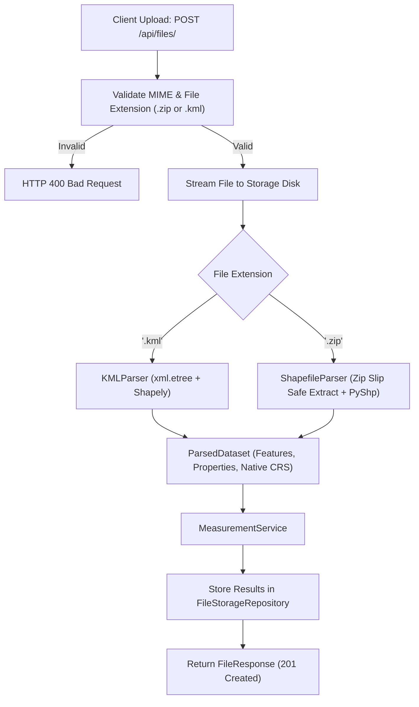
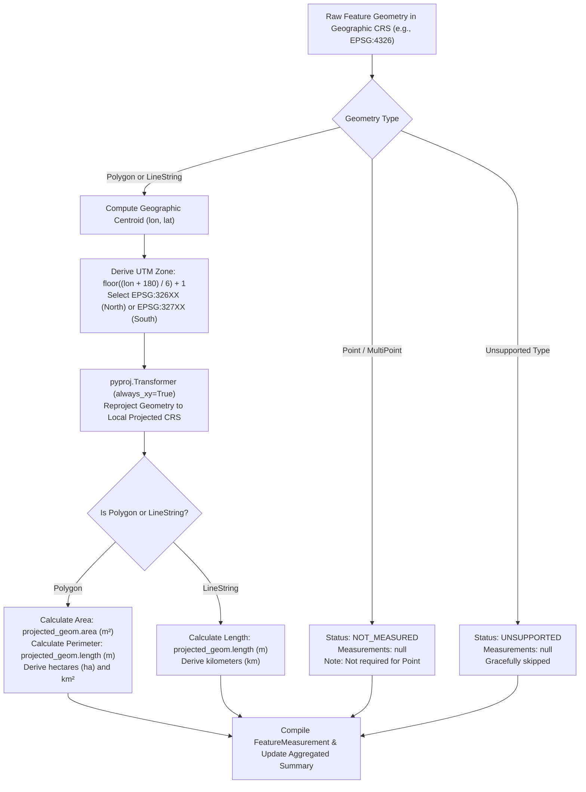

# Geospatial File Measurement API

A production-ready **FastAPI** backend service that ingests geospatial files (**ESRI Shapefiles in `.zip` archives** and **KML files**), extracts geometric features, dynamically transforms geographic coordinates into appropriate local metric projected coordinate systems (UTM), and computes precise geometric measurements (area, perimeter, length).

---

## Table of Contents
1. [Overview](#overview)
2. [Architecture](#architecture)
   - [Application Structure](#application-structure)
   - [File Processing Flow](#file-processing-flow)
   - [Measurement Calculation & CRS Pipeline](#measurement-calculation--crs-pipeline)
3. [CRS Handling Strategy](#crs-handling-strategy)
4. [API Documentation](#api-documentation)
   - [POST /api/files/](#1-upload-file)
   - [GET /api/files/{id}/](#2-get-file-information)
   - [GET /api/files/{id}/measurements/](#3-get-file-measurements)
   - [GET /api/files/](#4-list-all-files)
   - [DELETE /api/files/{id}/](#5-delete-file)
5. [Setup and Execution](#setup-and-execution)
   - [Prerequisites](#prerequisites)
   - [Local Installation](#local-installation)
   - [Running the Server](#running-the-server)
   - [Executing Tests](#executing-tests)
6. [Design Decisions & Alternatives](#design-decisions--alternatives)
7. [Learnings](#learnings)
8. [Future Improvements](#future-improvements)

---

## Overview

Working with geospatial files requires careful engineering around Coordinate Reference Systems (CRS) and geometric fidelity. A common pitfall in geospatial applications is calculating Euclidean distance or area directly on geographic coordinates (degrees of latitude and longitude, such as `EPSG:4326`). Because degrees vary in physical length across different latitudes, degree-based measurements are geometrically invalid.

This service:
- Accepts `.zip` containing Shapefiles (`.shp`, `.shx`, `.dbf`, `.prj`) or `.kml` files.
- Protects against **Zip Slip** directory traversal vulnerabilities during archive extraction.
- Parses features, attribute tables, and spatial geometries using `shapely` and `pyshp`.
- Identifies the native CRS (or defaults to `EPSG:4326` if `.prj` is omitted).
- Dynamically derives the optimal **local Universal Transverse Mercator (UTM) projection zone** based on the feature's geographic centroid.
- Reprojects geometries into the target metric system using `pyproj` (`always_xy=True`).
- Computes **area** (in $m^2$, hectares, and $km^2$) and **perimeter** for `Polygon` / `MultiPolygon`.
- Computes **length** (in meters and $km$) for `LineString` / `MultiLineString`.
- Gracefully handles `Point` geometries (`NOT_MEASURED`) and unsupported geometries (`UNSUPPORTED`) without crashing.
- Persists file records and measurement summaries in an extensible repository layer.

---

## Architecture

### Application Structure

```text
Aereo/
├── app/
│   ├── __init__.py
│   ├── main.py                     # FastAPI app initialization, middleware, routes, health probe
│   ├── config.py                   # App configuration (upload limits, file paths, default CRS)
│   ├── api/
│   │   ├── __init__.py
│   │   └── v1/
│   │       ├── __init__.py
│   │       ├── router.py           # API v1 route aggregator
│   │       └── endpoints.py        # /api/files/ upload, info, measurement endpoints
│   ├── schemas/
│   │   ├── __init__.py
│   │   ├── file.py                 # Pydantic v2 models for file upload & file metadata
│   │   └── measurement.py          # Pydantic v2 models for measurements and summaries
│   ├── services/
│   │   ├── __init__.py
│   │   ├── storage.py              # Thread-safe in-memory & file-backed storage repository
│   │   ├── crs_service.py          # Coordinate transformation & dynamic UTM projection
│   │   ├── measurement_service.py  # Geometric calculations & aggregate summary generation
│   │   └── parsers/
│   │       ├── __init__.py
│   │       ├── base.py             # Abstract Base Class for geospatial parsers
│   │       ├── shapefile_parser.py # Shapefile zip parser with Zip Slip security
│   │       └── kml_parser.py       # OGC KML 2.2 XML parser
│   └── utils/
│       └── __init__.py
├── samples/
│   ├── sample_survey.kml           # Valid KML with Polygon, LineString, and Point
│   └── sample_shapefile.zip        # Valid zipped ESRI Shapefile with .prj and attributes
├── scripts/
│   └── generate_samples.py         # Utility script to reproduce sample datasets
├── tests/
│   ├── __init__.py
│   ├── conftest.py                 # Pytest fixtures and FastAPI TestClient setup
│   ├── test_api_endpoints.py       # End-to-end API integration tests
│   ├── test_crs_transformation.py  # Unit tests for UTM detection and reprojection
│   ├── test_kml_parser.py          # Unit tests for KML placemark extraction
│   ├── test_measurement_service.py # Unit tests for area/length metrics and edge cases
│   └── test_shapefile_parser.py    # Unit tests for Shapefile archive extraction
├── .gitignore
├── requirements.txt
└── README.md
```

---

### File Processing Flow



---

### Measurement Calculation & CRS Pipeline



---

## CRS Handling Strategy

### Why Transforming to Projected CRS is Critical
Geographic coordinates (such as WGS 84, `EPSG:4326`) represent positions on an ellipsoidal Earth in degrees of latitude and longitude. 
- At the equator, 1 degree of longitude is approximately $111.32\text{ km}$.
- At 60° latitude, 1 degree of longitude shrinks to approximately $55.8\text{ km}$.
- At the poles, 1 degree of longitude converges to $0\text{ km}$.

Calculating area or distance using spherical degrees directly would yield distorted, meaningless numbers ($\text{degrees}^2$ or $\text{degrees}$).

### Chosen Strategy: Dynamic Centroid-Based UTM Projection
To ensure high accuracy across arbitrary global survey locations without requiring manual user intervention, this application implements a **Dynamic Centroid-Based Universal Transverse Mercator (UTM)** strategy:

1. **Centroid Extraction**: Calculate the centroid coordinate $(\text{lon}, \text{lat})$ of the feature in WGS 84.
2. **UTM Zone Calculation**:
   $$\text{zone} = \left\lfloor \frac{\text{lon} + 180}{6} \right\rfloor + 1 \quad (1 \le \text{zone} \le 60)$$
3. **EPSG Code Selection**:
   - **Northern Hemisphere** ($\text{lat} \ge 0$): `EPSG:32600 + zone` (e.g. Zone 43N in South Asia is `EPSG:32643`).
   - **Southern Hemisphere** ($\text{lat} < 0$): `EPSG:32700 + zone` (e.g. Zone 56S in Australia is `EPSG:32756`).
   - **Polar Regions** ($|\text{lat}| > 84^\circ$): Fallback to Universal Polar Stereographic (`EPSG:32661` / `EPSG:32761`) or World Equal Area (`EPSG:6933`).
4. **Coordinate Order Safety**:
   Transformations use `pyproj.Transformer.from_crs(source_crs, target_crs, always_xy=True)` to prevent the standard PROJ axis-order ambiguity ($[x, y] \equiv [\text{lon}, \text{lat}]$).
5. **Native Projected Preservation**:
   If an uploaded Shapefile already includes a projected coordinate reference system with linear meter units, the native projection is respected.

---

## API Documentation

### 1. Upload File
Uploads and synchronously processes a geospatial file.

- **URL**: `POST /api/files/`
- **Content-Type**: `multipart/form-data`
- **Parameters**: `file`: Geospatial file (`.zip` or `.kml`)

#### Example Request (cURL)
```bash
curl -X POST "http://127.0.0.1:8000/api/files/" \
  -F "file=@samples/sample_survey.kml"
```

#### Example Response (`201 Created`)
```json
{
  "id": "abc123456789",
  "filename": "sample_survey.kml",
  "feature_count": 3,
  "crs": "EPSG:4326",
  "status": "COMPLETED",
  "file_type": "KML",
  "uploaded_at": "2026-10-07T09:20:00Z",
  "error_message": null
}
```

---

### 2. Get File Information
Retrieves metadata and processing state for an uploaded file.

- **URL**: `GET /api/files/{id}/`

#### Example Request (cURL)
```bash
curl -X GET "http://127.0.0.1:8000/api/files/abc123456789/"
```

#### Example Response (`200 OK`)
```json
{
  "id": "abc123456789",
  "filename": "sample_survey.kml",
  "feature_count": 3,
  "crs": "EPSG:4326",
  "status": "COMPLETED",
  "file_type": "KML",
  "uploaded_at": "2026-10-07T09:20:00Z",
  "error_message": null
}
```

---

### 3. Get File Measurements
Returns calculated measurements for all features, projected CRS used, GeoJSON geometry representation, and an aggregated dataset summary.

- **URL**: `GET /api/files/{id}/measurements/`

#### Example Request (cURL)
```bash
curl -X GET "http://127.0.0.1:8000/api/files/abc123456789/measurements/"
```

#### Example Response (`200 OK`)
```json
{
  "id": "abc123456789",
  "filename": "sample_survey.kml",
  "feature_count": 3,
  "crs": "EPSG:4326",
  "summary": {
    "total_area_sq_meters": 303798.8124,
    "total_area_hectares": 30.379881,
    "total_length_meters": 781.4512,
    "total_length_km": 0.781451,
    "polygon_count": 1,
    "linestring_count": 1,
    "point_count": 1,
    "unsupported_count": 0
  },
  "features": [
    {
      "feature_id": "feature_001",
      "geometry_type": "Polygon",
      "geometry": {
        "type": "Polygon",
        "coordinates": [
          [
            [77.58, 12.96],
            [77.585, 12.96],
            [77.585, 12.965],
            [77.58, 12.965],
            [77.58, 12.96]
          ]
        ]
      },
      "crs": "EPSG:4326",
      "projected_crs": "EPSG:32643",
      "properties": {
        "name": "Agricultural Field 1",
        "crop_type": "Paddy",
        "surveyor": "Aereo Drone Team"
      },
      "measurements": {
        "area_sq_meters": 303798.8124,
        "area_hectares": 30.379881,
        "area_sq_km": 0.303799,
        "length_meters": 2205.12,
        "length_km": null,
        "note": "Area and perimeter calculated via metric projection."
      },
      "status": "PROCESSED"
    },
    {
      "feature_id": "feature_002",
      "geometry_type": "LineString",
      "geometry": {
        "type": "LineString",
        "coordinates": [
          [77.58, 12.96],
          [77.5825, 12.9625],
          [77.585, 12.965]
        ]
      },
      "crs": "EPSG:4326",
      "projected_crs": "EPSG:32643",
      "properties": {
        "name": "Flight Trajectory Alpha",
        "altitude_agl_m": "100",
        "speed_m_s": "12.5"
      },
      "measurements": {
        "area_sq_meters": null,
        "area_hectares": null,
        "area_sq_km": null,
        "length_meters": 781.4512,
        "length_km": 0.781451,
        "note": "Length calculated via metric projection."
      },
      "status": "PROCESSED"
    },
    {
      "feature_id": "feature_003",
      "geometry_type": "Point",
      "geometry": {
        "type": "Point",
        "coordinates": [77.5825, 12.9625]
      },
      "crs": "EPSG:4326",
      "projected_crs": null,
      "properties": {
        "name": "GCP 01",
        "accuracy_cm": "1.2"
      },
      "measurements": {
        "area_sq_meters": null,
        "area_hectares": null,
        "area_sq_km": null,
        "length_meters": null,
        "length_km": null,
        "note": "No measurement required for Point geometry."
      },
      "status": "NOT_MEASURED"
    }
  ]
}
```

---

### 4. List All Files
Returns a list of all tracked geospatial files.

- **URL**: `GET /api/files/`
- **Response**: List of `FileResponse` objects

---

### 5. Delete File
Deletes the file metadata, measurements, and extracted files on disk.

- **URL**: `DELETE /api/files/{id}/`
- **Response**: `204 No Content`

---

## Setup and Execution

### Prerequisites
- Python 3.10 or higher
- Git

### Local Installation

1. **Clone the repository**:
   ```bash
   git clone https://github.com/Harsha200621/geospatial-measurement-api.git
   cd geospatial-measurement-api
   ```

2. **Create and activate a virtual environment**:
   - On Windows (PowerShell):
     ```powershell
     python -m venv .venv
     Set-ExecutionPolicy -Scope Process -ExecutionPolicy RemoteSigned
     .\.venv\Scripts\Activate.ps1
     ```
   - On Linux / macOS:
     ```bash
     python3 -m venv .venv
     source .venv/bin/activate
     ```

3. **Install dependencies**:
   ```bash
   pip install -r requirements.txt
   ```

### Running the Server

Start the FastAPI application using Uvicorn:

```bash
uvicorn app.main:app --host 0.0.0.0 --port 8000 --reload
```

- **Interactive API Documentation (Swagger UI)**: [http://127.0.0.1:8000/docs](http://127.0.0.1:8000/docs)
- **Alternative Documentation (ReDoc)**: [http://127.0.0.1:8000/redoc](http://127.0.0.1:8000/redoc)
- **Health Check**: [http://127.0.0.1:8000/api/health](http://127.0.0.1:8000/api/health)

### Executing Tests

Run the full automated test suite with pytest:

```bash
pytest -v
```

All 22 unit and integration tests covering CRS reprojection, Shapefile parsing, KML placemarks, measurement algorithms, and API endpoints will execute.

---

## Design Decisions & Alternatives

| Decision | Choice Made | Alternatives Considered | Rationale |
| :--- | :--- | :--- | :--- |
| **Backend Framework** | **FastAPI** | Django + DRF | FastAPI provides native asynchronous I/O, automatic OpenAPI schema generation, fast serialization with Pydantic v2, and lightweight overhead without unnecessary ORM migrations for geospatial calculation workloads. |
| **Shapefile Parsing** | **PyShp (`shapefile`)** | `GDAL` / `Fiona` | `GDAL` and `Fiona` require complex C/C++ native system libraries that frequently cause compilation and wheel compatibility failures across Windows and Linux environments. `PyShp` is pure Python, cross-platform, robust, and performs flawlessly in containerized or local environments. |
| **Projection Strategy** | **Dynamic Centroid UTM Zone** | World Mercator (`EPSG:3857`) or Equal Area (`EPSG:6933`) | Web Mercator (`EPSG:3857`) has notorious scale distortion that inflates area by orders of magnitude away from the equator. UTM preserves conformal angles and scale with $<0.1\%$ distortion, making it the industry standard for drone survey analytics. |
| **KML Parsing** | **Standard `xml.etree.ElementTree`** | `fastkml` or `pykml` | Standard `xml.etree` has zero third-party C dependencies, avoids version incompatibilities with lxml, and provides direct namespace-agnostic traversal of standard OGC KML 2.2 schemas. |
| **Security Handling** | **Zip Slip Path Traversal Verification** | Naive `zipfile.extractall()` | Arbitrary ZIP archives could contain paths with `../` attempting to write outside target directories. Resolved paths are strictly verified against the target directory boundary. |
| **Persistence Layer** | **Repository Pattern (In-Memory + JSON)** | SQLite / PostgreSQL | Keeps local setup lightweight with zero database configuration hurdles while persisting state across server reboots. |

---

## Learnings

1. **CRS Axis Order Nuance (`always_xy=True`)**:
   In PROJ 6+ and EPSG definitions, geographic coordinates are strictly defined as `(latitude, longitude)`. However, GIS standards (like GeoJSON and Shapely) expect `(x, y)` which corresponds to `(longitude, latitude)`. Explicitly passing `always_xy=True` to `pyproj.Transformer` is essential to prevent reversed coordinates that project data into space or the ocean.
2. **KML Namespace Fragmentation**:
   Different GIS tools export KML with differing namespaces (`http://www.opengis.net/kml/2.2`, `http://earth.google.com/kml/2.1`, or default tags). Implementing namespace-agnostic tag parsing ensures compatibility regardless of whether the file was generated by Google Earth, QGIS, or drone software.
3. **Graceful Geometry Fallbacks**:
   Real-world survey files frequently contain non-measurement elements (Ground Control Points, camera stations, sensor marks) mixed with survey boundaries. Treating points as `NOT_MEASURED` rather than raising errors provides a seamless experience for surveyors.

---

## Future Improvements

- **Asynchronous Task Queue (Celery / Redis / ARQ)**: For processing large archives containing millions of features or high-density LIDAR transects asynchronously with webhook notifications.
- **GeoJSON / GeoPackage Export**: Adding `GET /api/files/{id}/export?format=geojson` allowing direct import into GIS platforms like QGIS or ArcGIS.
- **Spatial Database Integration**: Replacing in-memory repository with **PostGIS / SpatiaLite** for spatial indexing ($R\text{-tree}$) and spatial queries (bounding box filters, intersections).
- **3D Surface & Elevation Measurements**: Ingesting Digital Surface Models (DSM) or 3D TIN geometries to calculate surface volume (cut/fill analysis) and 3D terrain area.

---

## Author & Submission

- **Repository**: [https://github.com/Harsha200621/geospatial-measurement-api](https://github.com/Harsha200621/geospatial-measurement-api)
- **Author**: Harsha
- **Framework**: Python 3.10 | FastAPI | Shapely | Pyproj
